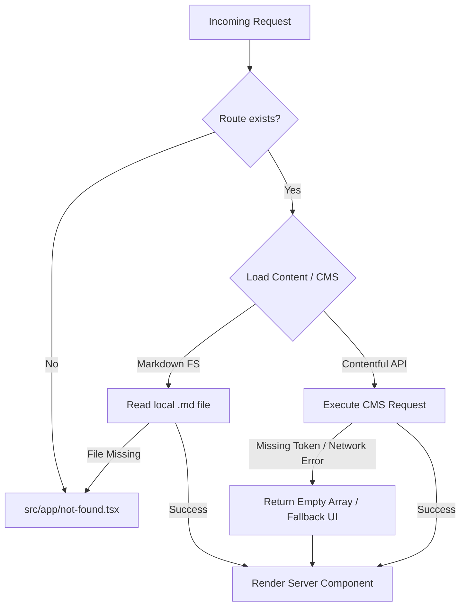

# System Architecture Specification — Nocturnal Codex

**Project:** Nocturnal Codex (`nocturnal-codex`)  
**Document:** `docs/architecture.md` / `docs/ARCHITECTURE.md`  
**Status:** Approved / Baseline Architecture  
**Author:** Senior Software Architect  

---

## 1. Executive Architectural Blueprint

Nocturnal Codex is engineered as a high-performance, hybrid content and interactive educational platform. It delivers rapid page loads via Next.js React Server Components (RSC) and Static Site Generation (SSG), while providing rich app-like visual learning HUDs powered by `@xyflow/react` on client hydration.

```mermaid
graph TD
    subgraph Data Layer
        A1[Local Markdown: Languages & Math]
        A2[Local JSON: Roadmap Canvases]
        A3[Contentful CMS: Blog & Think Tank]
    end

    subgraph Server Layer (Next.js 15 RSC)
        B1[Data Loaders: src/lib/]
        B2[App Router Pages: src/app/]
        B3[Server Pre-rendering & SEO Ingestion]
    end

    subgraph Client Layer (React 18)
        C1[EditorRoadmapRenderer & React Flow]
        C2[RoadmapDrawer & Modal Overlays]
        C3[Theme Toggle & Interactive Controls]
    end

    A1 -->|fs.readFileSync + gray-matter| B1
    A2 -->|JSON parser| B1
    A3 -->|GraphQL / REST API with Fallback| B1
    B1 --> B2
    B2 --> B3
    B3 -->|Pre-rendered HTML + initialData| C1
    C1 --> C2
    C3 -.-> C1
```

---

## 2. Technology Stack & Technical Justification

| Technology | Version / Configuration | Architectural Justification |
| :--- | :--- | :--- |
| **Next.js** | `15.6.0-canary.60` (App Router, Turbopack) | Native React Server Components (RSC) eliminate runtime JavaScript for 90% of content pages. SSG pre-renders 635+ pages in ~25s. ISR enables fresh dynamic content without cold rebuilds. |
| **TypeScript** | `5.2.0` (`strict: true`) | Enforces end-to-end type safety across frontmatter parsing, CMS payloads, graph schemas, and component interfaces. Prevents runtime property crashes. |
| **React** | `18.3.1` | Concurrent hydration, server/client boundary clarity via `'use client'`, and granular Suspense boundaries. |
| **Tailwind CSS** | `3.3.0` + Plugins | Zero runtime CSS footprint. Design system tokens are compiled ahead-of-time. Typography plugin styles raw markdown with editorial elegance. |
| **Radix UI & Shadcn** | Unstyled / Headless | Provides accessible primitives (Sheet, Dialog, Dropdown, Accordion) complying with WAI-ARIA standards while retaining bespoke Neo-Brutalist styling. |
| **React Flow** | `@xyflow/react` v12.0.4 | Industry-standard graph engine utilized as a read-only, responsive infographic canvas with custom node components. |
| **Contentful CMS** | Headless API | Decouples dynamic editorial publishing (Blog, Think Tank) from code releases, backed by strict error-resilient fallback handlers. |
| **Markdown Pipeline** | `gray-matter`, `remark`, `remark-gfm` | Robust static parsing of curriculum markdown into semantic HTML with metadata extraction. |

---

## 3. Directory & Component Structure

```
nocturnal-codex/
├── docs/                      # Architectural, requirements, design, and testing specs
├── public/                    # Static assets (images, icons, fonts)
│   └── roadmap-content/       # React Flow graph canvases (nodes, edges, topics)
├── src/
│   ├── app/                   # Next.js App Router (pages, layouts, loading, errors)
│   │   ├── (routes)/          # /roadmaps, /languages, /mathematics, /projects, etc.
│   │   ├── globals.css        # Global CSS variables & Tailwind layer configuration
│   │   ├── layout.tsx         # Root layout (Theme provider, Navbar, Footer)
│   │   ├── not-found.tsx      # Global 404 handler
│   │   ├── robots.ts          # Dynamic robots.txt generation
│   │   └── sitemap.ts         # Dynamic sitemap.xml generation
│   ├── components/            # UI Components partitioned by architectural role
│   │   ├── common/            # Shared primitives (Spinner, SimpleIcon)
│   │   ├── content/           # Content presentation (BlogPostCard, RandomTheoryDrop)
│   │   ├── contentful/        # Rich text renderers for CMS payloads
│   │   ├── EditorRoadmap/     # Canvas container & React Flow runtime engine
│   │   ├── forms/             # Client form components (ContactForm with Zod)
│   │   ├── layout/            # Shell components (Navbar, Footer, Breadcrumbs, Sidebars)
│   │   ├── Roadmaps/          # Custom Neo-Brutalist nodes, edges, and drawers
│   │   ├── theme/             # Theme provider and theme toggle button
│   │   └── ui/                # Headless Shadcn / Radix primitives
│   ├── content/               # Version-controlled curriculum markdown files
│   │   ├── languages/         # 22+ Programming language curricula (400+ lessons)
│   │   ├── mathematics/       # Pure and applied math topic guides
│   │   ├── projects/          # Curated open-source projects per language
│   │   └── roadmaps/          # Roadmap narrative guides and overviews
│   ├── hooks/                 # Custom React hooks (use-toast)
│   ├── lib/                   # Data access layer, API clients, and static loaders
│   │   ├── contentful.ts      # CMS client with offline/missing-token fallback
│   │   ├── languages.ts       # File-system markdown loader with in-memory cache
│   │   ├── mathematics.ts     # Mathematics content loader
│   │   ├── projects.ts        # Open-source project directory loader
│   │   ├── roadmaps.ts        # Roadmap metadata and lesson interconnects
│   │   └── utils.ts           # Class merge (cn) and formatting helpers
│   └── types/                 # Shared TypeScript domain contracts
└── next.config.ts             # Next.js build and image optimization configuration
```

---

## 4. Routing & Navigation Architecture

The site uses file-system routing powered by Next.js 15 App Router:

```
/                              -> HomePage (Landing HUD)
├── /roadmaps                  -> Roadmap Index
│   └── /[roadmapId]           -> Interactive React Flow Canvas + SEO semantic tree
│       └── /[topicId]         -> Deep-dive Topic Syllabus Page
├── /languages                 -> Programming Languages Catalog
│   └── /[slug]                -> Language Overview & Syllabus
│       └── /[topicSlug]       -> Markdown Lesson with Syntax Highlighting
├── /mathematics               -> Mathematics Foundations Catalog
│   └── /[slug]                -> Math Domain Overview
│       └── /[topicSlug]       -> Theoretical & Applied Math Lesson
├── /projects                  -> Open-Source Curated Projects Directory
├── /blog                      -> Technical Blog Index (Contentful ISR)
│   └── /[slug]                -> Article View
├── /think-tank                -> Research & Whitepapers Index (Contentful ISR)
│   └── /[slug]                -> Research Article View
├── /about                     -> Philosophy & Manifesto
├── /contact                   -> Inquiries & Validated Feedback Form
└── /tags & /categories        -> Cross-cutting Taxonomy Indexes
```

### Navigation State:
- Navigation items are centrally declared in `src/lib/data.ts` (`NAV_ITEMS`).
- Active routes are determined via `usePathname()` with distinct active styling.
- Responsive sheet drawer provides full mobile accessibility.

---

## 5. Data Models & API Requirements

### 5.1 Domain Contracts
- **`BlogPost`**: ID, slug, title, ISO date, summary, rich-text `content`, author, tags, category, featured status, image.
- **`ThinkTankArticle`**: ID, slug, title, ISO date, abstract, citations, PDF link, discipline, rich-text `content`.
- **`Language`**: ID, name, slug, description, icon name, paradigms, difficulty, markdown body, tutorial topics.
- **`Roadmap`**: Slug, title, description, category, difficulty, order, estimated hours, chapter count, related languages.
- **`InHouseProjectItem`**: ID, title, description, difficulty (`Beginner` | `Intermediate` | `Advanced`), repo URL, good-first-issues URL.

### 5.2 React Flow Graph Schema (`public/roadmap-content/*.json`)
```typescript
interface RoadmapCanvasJSON {
  nodes: Array<{
    id: string;
    type: 'topic' | 'section' | 'subtopic' | 'blue' | 'info' | 'label';
    position: { x: number; y: number };
    data: {
      label: string;
      status?: 'recommended' | 'alternative' | 'optional';
      description?: string;
      codeSnippet?: string;
      prerequisites?: string[];
      resources?: Array<{ title: string; url: string; type: string }>;
      relatedLanguage?: string;
    };
  }>;
  edges: Array<{
    id: string;
    source: string;
    target: string;
    type?: 'roadmap' | 'dotted';
  }>;
}
```

---

## 6. Authentication & Authorization

- **Public Access Model:** Nocturnal Codex is an open-access knowledge sanctuary. No authentication is required for browsing curricula, roadmaps, lessons, or projects.
- **Editorial Authorization:** CMS content entry is authenticated and authorized externally via Contentful's SOC-2 compliant OAuth2/SSO interface.
- **Secrets Isolation:** No API tokens or write keys are exposed to the browser. Read-only CMS tokens reside exclusively on the server side (`src/lib/contentful.ts`).

---

## 7. State Management Architecture

A server-first unidirectional pattern is strictly maintained:

1. **Server-Side State:** Dynamic data is fetched directly inside Server Components and passed as immutable props. No client stores (e.g. Redux, Zustand) are required.
2. **Interactive UI State:** Managed via localized React state (`useState`, `useCallback`, `useMemo`):
   - `EditorRoadmapRenderer`: Tracks `selectedNode` and `drawerOpen`.
   - `Navbar`: Tracks mobile `isSheetOpen`.
   - `ContactForm`: Manages field validation state and submission spinner.
3. **Theme State:** Persisted via `localStorage` through `next-themes` (`light`, `dark`, `system`).

---

## 8. Error Handling & Fault Tolerance



- **Missing CMS Credentials:** If `CONTENTFUL_SPACE_ID` or `CONTENTFUL_ACCESS_TOKEN` is unset, `contentful.ts` gracefully logs a warning and returns safe fallbacks without throwing build exceptions.
- **Malformed Markdown / JSON:** Protected with `try/catch` wrappers falling back to empty datasets.

---

## 9. Accessibility (a11y) & Performance Strategy

### 9.1 Accessibility
- **WCAG 2.1 AA Compliance:** High color contrast across light parchment (4.5:1+) and OLED dark modes.
- **Roadmap Screen Reader Tree:** Canvas visual nodes are backed by an invisible, fully semantic HTML hierarchy (`sr-only`) containing headings and resource links.
- **Focus Management:** Visible `:focus-visible` ring outlines, focus trapping in drawers (`RoadmapDrawer`), and `Esc` key dismissal.

### 9.2 Performance
- **Zero Client Cascades:** Static pre-rendering of 635 pages eliminates network waterfalls.
- **Code Splitting:** `@xyflow/react` is isolated strictly to roadmap routes.
- **Image Optimization:** Next.js `<Image>` provides automatic WebP/AVIF formatting, responsive sizing, and blur placeholders.

---

## 10. Deployment & Infrastructure Considerations

- **Primary Target:** Vercel or cloud container platform supporting Node.js 20+ runtime.
- **Runtime Environment:** Node.js `v20.20.2` specified in `.nvmrc`.
- **Environment Variables Required in Production:**
  - `NEXT_PUBLIC_SITE_URL`: Canonical URL for SEO sitemaps and OpenGraph metadata.
  - `CONTENTFUL_SPACE_ID`: Production Contentful Space ID.
  - `CONTENTFUL_ACCESS_TOKEN`: Production Contentful Delivery API token.
- **Static Export Fallback:** Can also be statically exported to `out/` for edge hosting (e.g., GitHub Pages) using the workflow in `.github/workflows/deploy-pages.yml`.
