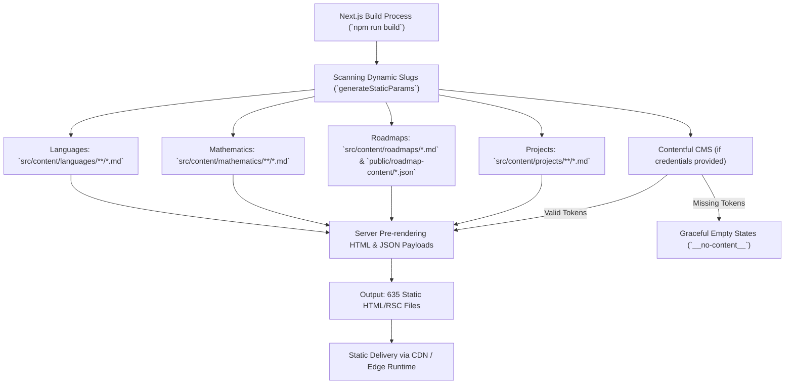
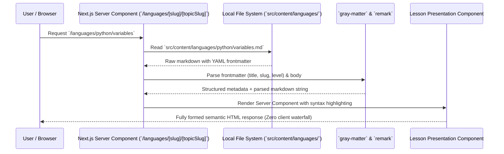
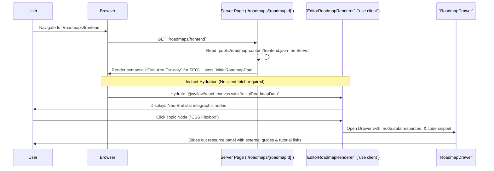
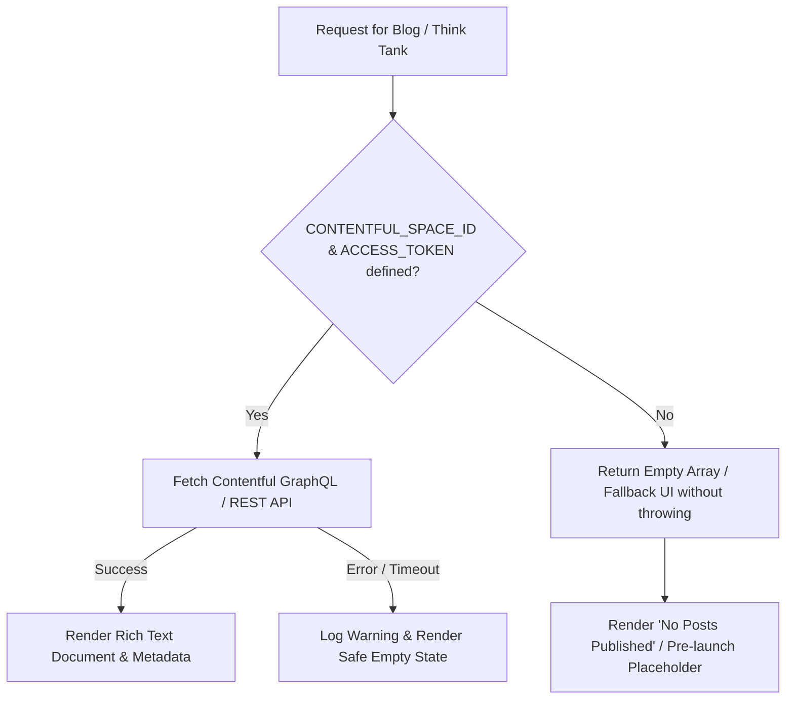
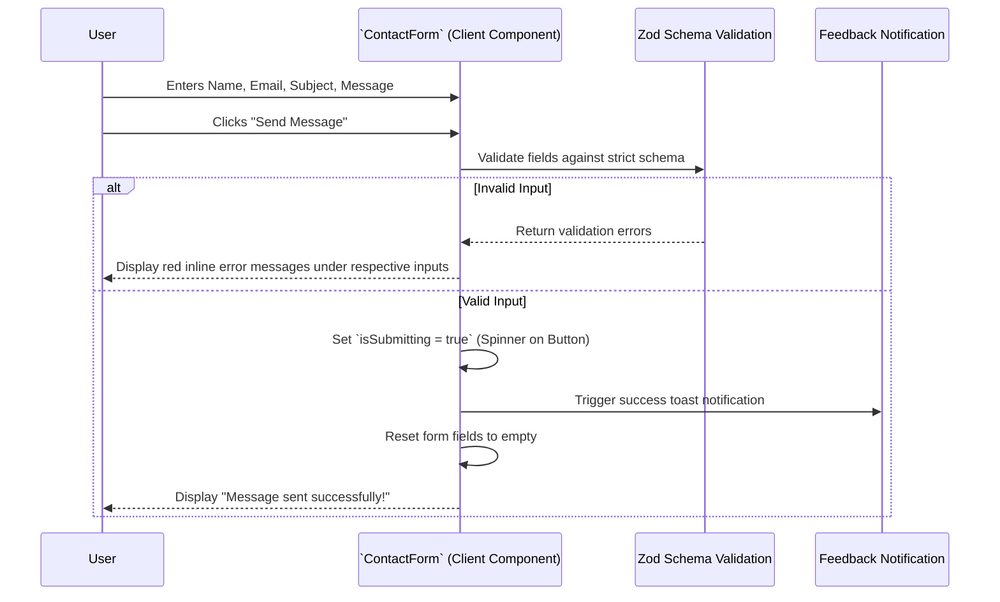

# System Execution & Data Flow — Nocturnal Codex

**Project:** Nocturnal Codex  
**Document:** `docs/flow.md`  

This document details the complete end-to-end execution and data flow lifecycles across Nocturnal Codex:
1. Static Site Generation & ISR Build Lifecycle
2. Markdown & Curriculum Content Resolution Flow
3. Interactive Roadmap Hydration & React Flow Lifecycle
4. Contentful Headless CMS Ingestion & Fallback Flow
5. User Navigation & Client-Side Transition Flow

---

## 1. Static Site Generation & ISR Lifecycle

---

## 2. Markdown Curriculum Content Flow

---

## 3. Interactive Roadmap Hydration & React Flow Engine

---

## 4. Contentful Headless CMS & Graceful Fallback Flow

---

## 5. Contact Form Boundary & User Journey Flow

